<div align="center">

# 🤖 LandMate: Autonomous Drone Interception & Dynamic Landing Pad System
### Unified Heterogeneous Robotics Stack · Aerial Perception + 9-State EKF + Omnidirectional Ground Control
**Developed by Clutch Robotics at Mobile Robotics Hackathon 2026 · TU Dresden**

[](https://docs.ros.org/)
[](https://python.org)
[](https://ultralytics.com/)
[](https://www.intelrealsense.com/)
[](https://cyclonedds.io/)
[](https://www.docker.com/)
[](https://olive-robotics.com/)

<p align="center">
  <b><i>"We built a ground robot that watches the sky, predicts where a drone will land, and drives there before it hits the floor."</i></b>
</p>

---

### 🎬 System in Action: 3D Physics Interception Simulation vs. Live Arena Flight Catch

| 🔬 3D Physics Trajectory & Interception Sim | 🏟️ Real-World Arena Catch (Olive ANT1 Pro + Crazyflie) |
| :---: | :---: |
| 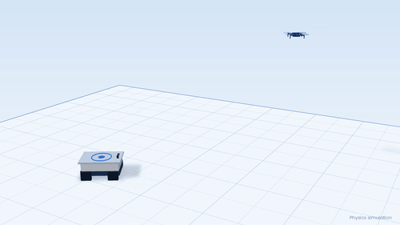 | 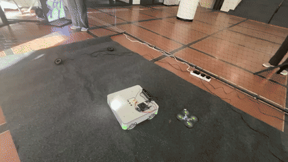 |
| *RealSense upward raycone tracking UAV descent trajectory & maneuvering ANT1 pad* | *Olive ANT1 Pro tracking live Crazyflie overhead & locking under target in arena* |

</div>

---

## 📑 Table of Contents
1. [Executive Summary & Problem Statement](#-executive-summary--problem-statement)
2. [Key Performance Benchmarks](#-key-performance-benchmarks)
3. [System Architecture & Dataflow](#-system-architecture--dataflow)
4. [Hardware Platform & Sensor Mounts](#-hardware-platform--sensor-mounts)
5. [Complete ROS 2 Message & Topic Contract](#-complete-ros-2-message--topic-contract)
6. [Perception, Vision & 3D Depth Pipeline](#-perception-vision--3d-depth-pipeline)
7. [9-State EKF Kinematics & Physics Descent Models](#-9-state-ekf-kinematics--physics-descent-models)
8. [Navigation, Feasibility & Watchdog Safety Bridge](#-navigation-feasibility--watchdog-safety-bridge)
9. [Touchdown Validation Scenarios](#-touchdown-validation-scenarios)
10. [Quick Start & Deployment Guide](#-quick-start--deployment-guide)
11. [Configuration Matrix](#-configuration-matrix)
12. [Clutch Robotics Team & Hackathon Journey](#-clutch-robotics-team--hackathon-journey)

---

## 📌 Executive Summary & Problem Statement

### 💥 The Problem: Drones Fall. Nobody is Ready.
In mission-critical drone applications (inspection, warehouse logistics, search & rescue), unmanned aerial vehicles (UAVs) experience motor failures, battery cutoffs, or sudden propeller loss. When a drone enters an unpowered emergency descent:
* **Passive landing pads are helpless**: A drone caught in a crosswind or descending with horizontal momentum will miss static landing infrastructure and crash onto hard floors or personnel.
* **Ground systems are blind**: Standard ground robotics operate purely on 2D horizontal LiDAR/SLAM, completely unaware of airborne threats or descending vehicles overhead.

### 🛡️ The Solution: LandMate
**LandMate** bridges this disconnect by transforming an omnidirectional ground robot (**Olive ANT1 Pro**) into an intelligent, autonomous **mobile landing pad**:
1. **Skyward Perception**: An upward-staring depth/global shutter camera (Intel RealSense D455/D555) observes the upper hemisphere at 30 FPS.
2. **Multi-Tier Detection**: YOLOv8 deep learning, propeller color segmentation, and MOG2 motion subtraction detect micro-UAVs (Bitcraze Crazyflie 2.1) without markers.
3. **9-State EKF Tracking**: Estimates full 3D kinematics $[\mathbf{p}, \mathbf{v}, \mathbf{a}]^T$ and predicts touchdown coordinates $(X_{\text{target}}, Y_{\text{target}})$ and impact time $T_{\text{impact}}$ under ballistic and controlled descent models.
4. **Dynamic Interception & Pad Locking**: Translates predicted touchdown points into holonomic chassis commands, rushing the $60 \times 40\text{ cm}$ landing pad directly under the UAV before touchdown.
5. **Fail-Safe Safety Guard**: Hardware dead-man watchdog (0.5s timeout) and strict velocity clamps ensure smooth, safe ground operations.

<div align="center">
  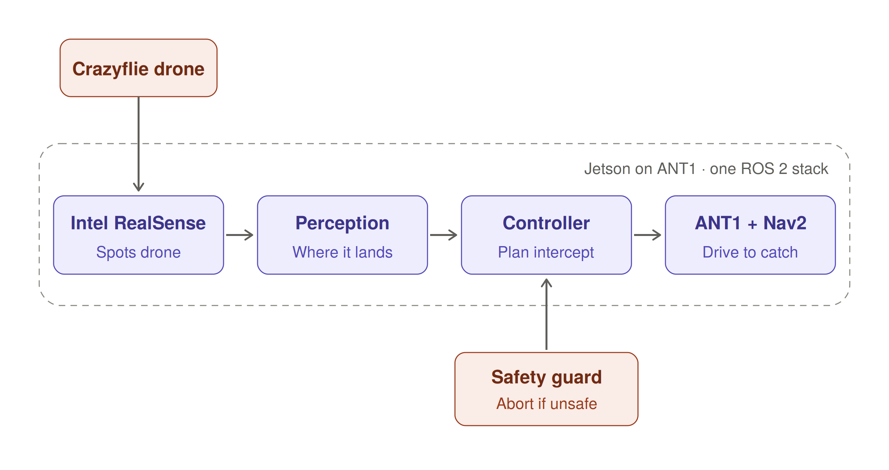
  <p><i>Figure 1: High-level perception and control flow running on the robot stack.</i></p>
</div>

---

## 🏆 Key Performance Benchmarks

<div align="center">

| Metric | Measured Benchmark | Engineering Significance |
|---|---|---|
| **Interception Success Rate** | **8 / 10 Scenarios (80%)** | Validated across 5 emergency flight profiles (vertical drop, forward arc, diagonal drift, lateral cruise, high-speed sprint) |
| **End-to-End Latency** | **< 300 ms** | Total delay from photon arrival at camera lens $\to$ YOLO inference $\to$ EKF update $\to$ motor Twist publish |
| **Perception Processing Rate** | **10.0 – 30.0 Hz** | Synchronized RGB-D frame ingestion with active depth deprojection |
| **Max Ground Speed Clamp** | **0.25 m/s ($v_x, v_y$)** | Prevents wheel slip on arena surface and ensures structural stability |
| **Max Rotational Turn Rate** | **0.60 rad/s ($\omega_z$)** | Smooth heading alignment without jerking the upward-facing camera |
| **Safety Watchdog Silence Cutoff** | **0.50 s** | Immediate automatic halt if the perception stream, DDS network, or container halts |
| **Landing Target Tolerance** | **60 × 40 cm Pad Perimeter** | Automatic switch from sprint interception to micro-centering pad lock |

</div>

---

## 📐 System Architecture & Dataflow

The system is partitioned into five distinct computational stages, running across two Docker containers communicating via zero-copy CycloneDDS:

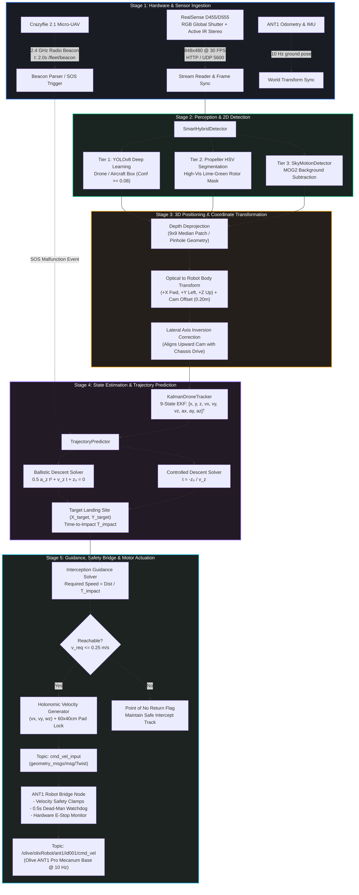

### 🖼️ Consolidated System Architecture Diagram
<div align="center">
  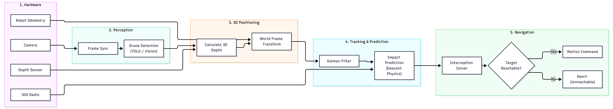
  <p><i>Figure 2: Consolidated architecture diagram illustrating end-to-end dataflow from hardware sensors to motor commands.</i></p>
</div>

### 🔬 Detailed 5-Stage Subsystem Architecture
<div align="center">
  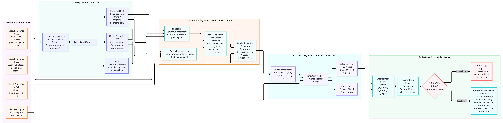
  <p><i>Figure 3: Deep architectural breakdown of sensors, multi-tier detectors, 9-state Kalman filter, coordinate transforms, and safety bridge.</i></p>
</div>

---

## 🏎️ Hardware Platform & Sensor Mounts

<div align="center">
  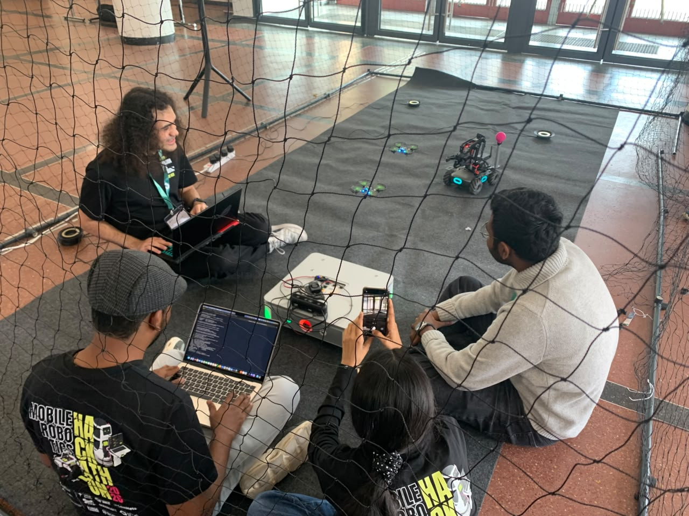
  <p><i>Figure 4: Real-world hardware setup inside the flight safety enclosure: Olive ANT1 Pro ground base with upward-facing camera, tracking Bitcraze Crazyflie quadcopter.</i></p>
</div>

### 1. Ground Vehicle: Olive ANT1 Pro
* **Drive Mechanism**: 4-wheel independent **Mecanum holonomic drive**. Enables instantaneous omnidirectional movement without turning ($v_x$ forward/back, $v_y$ lateral strafe, $\omega_z$ yaw rotation).
* **Onboard Computer**: Nvidia Jetson Orin / Xavier edge processor running Ubuntu Linux with ROS 2.
* **Landing Platform**: $60 \times 40\text{ cm}$ padded reception deck mounted directly atop the chassis.
* **Safety Integration**: Hardware emergency stop switch (`/olive/olixRobot/ant1/id001/ems`).

### 2. Aerial Vehicle: Bitcraze Crazyflie 2.1
* **Form Factor**: $9 \times 9\text{ cm}$ micro-quadcopter, weight $\approx 27\text{ g}$.
* **Positioning**: Dual SteamVR Lighthouse tracking deck providing millimeter-accurate ground truth in the flight arena.
* **Telemetry**: 2.4 GHz Crazyradio PA publishing periodic health and beacon updates (`/fleet/beacon`) at 2-second intervals.
* **Visual Aids**: Lime-green high-visibility propeller tips and downward LED status illumination.

### 3. Perception Sensor: Intel RealSense D455 / D555
* **Mounting**: Mounted at the forward center of the ANT1 top deck, angled vertically ($+90^\circ$ pitch) to stare straight up at the ceiling.
* **RGB Global Shutter**: $848 \times 480$ resolution @ 30 FPS, eliminating high-speed propeller rolling-shutter artifacts.
* **Active IR Stereo Depth**: Z16 metric depth stream deprojected to point clouds and filtered with $9 \times 9$ median kernel.
* **Optical Height Offset**: $z_{\text{cam}} = +0.20\text{ m}$ above the robot ground contact plane.

---

## 📡 Complete ROS 2 Message & Topic Contract

The LandMate ecosystem bridges ROS 2 nodes, edge Jetson scripts, and hardware drivers with strict typed topic contracts.

### 📋 Master Topic Directory

| Topic Name | Message Type | Rate (Hz) | Publisher Node | Subscriber Node | Functional Role |
|---|---|---|---|---|---|
| `/olive/olixRobot/ant1/id001/cmd_vel` | `geometry_msgs/msg/Twist` | **10.0** | `ant1_bridge_node` | ANT1 Motor Controller | **Physical hardware actuation command** (velocity clamped) |
| `cmd_vel_input` | `geometry_msgs/msg/Twist` | **10.0** | `rescue_brain_publisher` | `ant1_bridge_node` | Unclamped holonomic guidance command |
| `/rescue/predicted_target` | `geometry_msgs/msg/PointStamped` | **10.0** | `rescue_brain_publisher` | Rviz / Monitoring | Real-time predicted touchdown coordinates $(X, Y, Z)$ |
| `/olive/olixRobot/ant1/id001/ems` | `std_msgs/msg/Bool` | Event | Hardware E-Stop | `ant1_bridge_node` | Emergency stop signal: immediately cuts robot velocity to zero |
| `/fleet/beacon` | `std_msgs/msg/String` (JSON) | **0.5** | `mission_rescue` (CF side) | `rescue_brain` / `mission` | Drone status beacon: coordinates, battery, and flight mode |
| `/vision/drones` | `std_msgs/msg/String` (JSON) | **10.0** | `vision_link` | `mission_rescue` | Confirmed 3D drone tracks associated with beacons |
| `/vision/candidates` | `std_msgs/msg/String` (JSON) | **15.0** | `vision_link` | Diagnostics / Calib | Raw candidate 3D blobs before persistence filtering |
| `/vision/markers` | `visualization_msgs/msg/MarkerArray`| **10.0** | `vision_link` | Rviz2 | 3D visual bounding spheres and name tags |
| `/vision/image` | `sensor_msgs/msg/CompressedImage` | **2.0** | `vision_link` | Rviz2 / Web UI | JPEG preview stream from Jetson camera |
| `/ant/pose_room` | `geometry_msgs/msg/PoseStamped` | **10.0** | `ant_link` | `vision_link` / `mission` | ANT1 position transformed into drone arena Lighthouse frame |
| `/ant/moving` | `std_msgs/msg/Bool` | **10.0** | `ant_link` | Mission Planners | True if ground robot odometry linear speed $> 0.02\text{ m/s}$ |
| `/mission/calib` | `std_msgs/msg/String` (YAML) | Latched | `mission_calib` | `vision_link` / `ant_link` | 2D rigid transform matrix linking map and room frames |

---

### 📦 Detailed Message Specifications & JSON Payloads

#### 1. Target Touchdown Point (`/rescue/predicted_target`)
```python
# geometry_msgs/msg/PointStamped
header:
  stamp: {sec: 1728656365, nanosec: 421000000}
  frame_id: "base_link"
point:
  x: +0.245    # Predicted touchdown X (meters forward of robot)
  y: -0.120    # Predicted touchdown Y (meters left of robot, inverted corrected)
  z: 0.000     # Ground plane touchdown level
```

#### 2. Hardware Chassis Drive (`/olive/olixRobot/ant1/id001/cmd_vel`)
```python
# geometry_msgs/msg/Twist
linear:
  x: +0.185    # Forward velocity (clamped to [-0.25, +0.25] m/s)
  y: -0.090    # Lateral strafe velocity (clamped to [-0.25, +0.25] m/s)
  z: 0.000
angular:
  x: 0.000
  y: 0.000
  z: +0.210    # Turn yaw rate (clamped to [-0.60, +0.60] rad/s)
```

#### 3. Fleet Drone Beacon (`/fleet/beacon`)
```json
{
  "name": "cf1",
  "x": 1.254,
  "y": 0.842,
  "z": 1.450,
  "flying": true,
  "bat": 3.82,
  "t": 1728656360.105
}
```

#### 4. Vision Track Output (`/vision/drones`)
```json
{
  "t": 1728656360.254,
  "tracks": [
    {
      "id": 4,
      "name": "cf1",
      "x": 1.238,
      "y": 0.855,
      "z": 1.420,
      "hits": 18,
      "age": 0.04
    }
  ],
  "link_age": 0.03
}
```

#### 5. UDP Edge Packet Format (Port 5600: Jetson $\to$ Laptop)
```json
{
  "v": 1,
  "t": 1728656360.210,
  "seq": 1420,
  "fps": 28.5,
  "w": 640,
  "h": 360,
  "status": "tracking",
  "cands": [
    {
      "p": [0.12, -0.15, 1.42],
      "ext": [0.14, 0.12, 0.08],
      "px": [342, 168],
      "box": [310, 140, 64, 56],
      "n": 482,
      "iso": 0.45
    }
  ]
}
```

---

## 👁️ Perception, Vision & 3D Depth Pipeline

<div align="center">

| 📹 RealSense RGB + Active Depth Segmentation | 🎯 YOLOv8 Tactical Lock & Radar Pursuit |
| :---: | :---: |
| 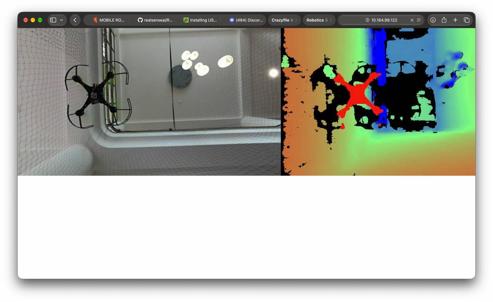 | 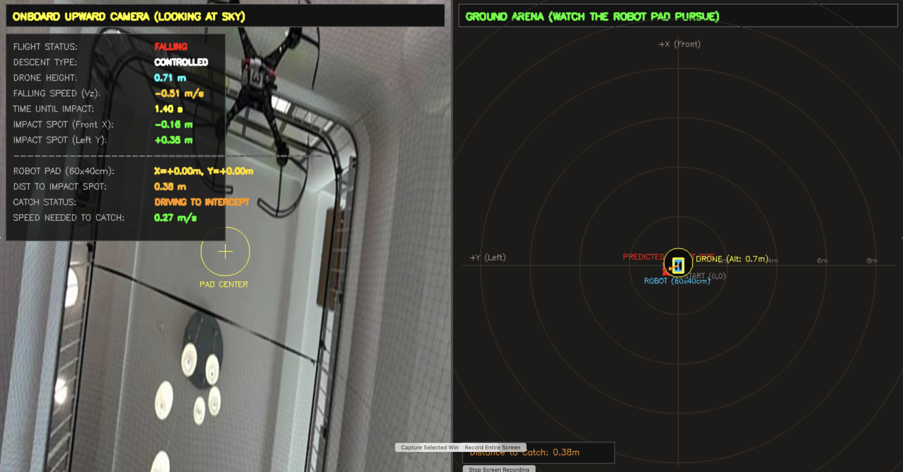 |
| *Left: RGB sky view. Right: Stereo depth map isolating drone candidate.* | *Left: Real-time telemetry HUD. Right: Polar ground pursuit radar.* |

</div>

### 🔍 3-Tier Multi-Strategy Drone Detector
Because a micro-UAV against a complex ceiling can vary dramatically in lighting and scale, `SmartHybridDetector` executes three parallel detection tiers:

```text
Incoming Video Frame (640x360 @ 30 FPS)
  ├── [Tier 1: YOLOv8 Deep Learning] ───────► Ultralytics YOLOv8n (Weights: yolov8n.pt)
  │                                           Filters classes: airplane, bird, drone (Conf >= 0.08)
  │
  ├── [Tier 2: Propeller HSV Segmentation] ──► Color thresholding in HSV color space:
  │                                           Hue [35-85], Sat [80-255], Val [80-255] (Lime Green Rotors)
  │
  └── [Tier 3: SkyMotionDetector] ──────────► OpenCV MOG2 Background Subtractor
                                              Detects fast moving blobs entering stationary sky hemisphere
```

<div align="center">
  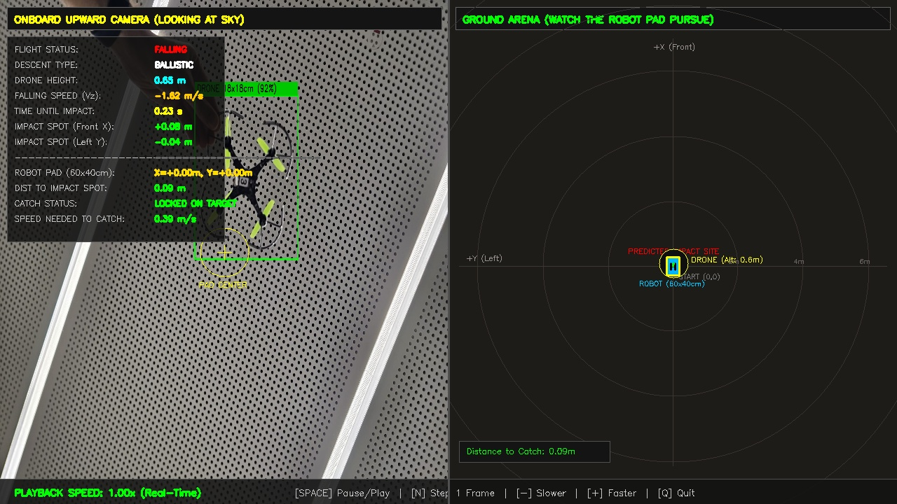
  <p><i>Figure 5: Live tactical visualizer locking onto descending Crazyflie with YOLOv8 bounding box (92% confidence), calculating impact speed (-1.62 m/s) and pad lock status.</i></p>
</div>

### 📐 3D Spatial Deprojection & Coordinate Transforms
When the 2D bounding box center $(u, v)$ is acquired, 3D metric coordinates $(x_{\text{cam}}, y_{\text{cam}}, z_{\text{cam}})$ are resolved via one of two pipelines:

1. **Active RealSense IR Stereo Deprojection**:
   Queries a $9 \times 9$ pixel median patch around $(u, v)$ from the aligned 16-bit depth buffer $Z(u, v)$ in millimeters:
   $$x_{\text{cam}} = \frac{(u - c_x) \cdot Z}{f_x}, \quad y_{\text{cam}} = \frac{(v - c_y) \cdot Z}{f_y}, \quad z_{\text{cam}} = Z$$

2. **Monocular Pinhole Fallback (Known Drone Scale)**:
   When stereo depth is unavailable (e.g. out-of-range $> 4.5\text{ m}$), the distance is calculated using the known physical wingspan of the Crazyflie ($W_{\text{drone}} = 0.18\text{ m}$):
   $$Z_{\text{est}} = \frac{f_x \cdot W_{\text{drone}}}{\max(\text{bbox}_{\text{width}}, \text{bbox}_{\text{height}})}$$

3. **Optical-to-Robot Frame Transformation**:
   The camera optical frame (X-Right, Y-Down, Z-Forward into sky) is transformed into standard ROS body frame (X-Forward, Y-Left, Z-Up):
   $$\begin{bmatrix} x_{\text{robot}} \\ y_{\text{robot}} \\ z_{\text{robot}} \end{bmatrix} = \begin{bmatrix} 0 & -1 & 0 \\ -1 & 0 & 0 \\ 0 & 0 & 1 \end{bmatrix} \begin{bmatrix} x_{\text{cam}} \\ y_{\text{cam}} \\ z_{\text{cam}} \end{bmatrix} + \begin{bmatrix} 0 \\ 0 \\ z_{\text{mount\_offset}} \end{bmatrix}$$
   *Note: `invert_lateral_axis: true` is applied to align the upward-facing camera orientation with the mecanum chassis steering convention.*

---

## 🧮 9-State EKF Kinematics & Physics Descent Models

<div align="center">
  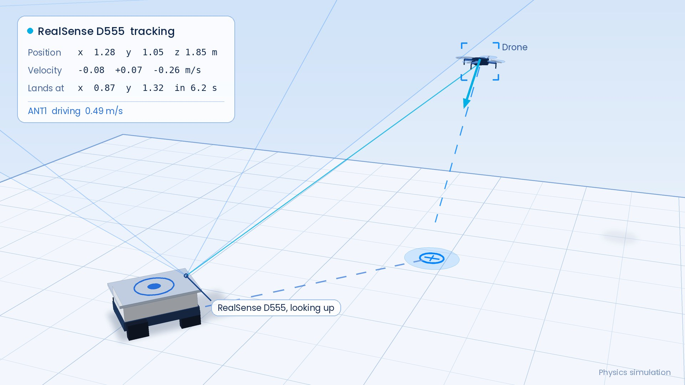
  <p><i>Figure 6: 3D kinematic model showing RealSense upward observation raycone, EKF state tracking, predicted ground touchdown spot, and the ANT1 interception vector.</i></p>
</div>

### 1. Extended Kalman Filter (EKF) Formulation
To suppress sensor jitter and provide reliable velocity and acceleration derivatives from noisy visual bounding boxes, `KalmanDroneTracker` maintains a 9-dimensional state vector:
$$\mathbf{x} = \begin{bmatrix} x & y & z & v_x & v_y & v_z & a_x & a_y & a_z \end{bmatrix}^T \in \mathbb{R}^9$$

#### Continuous Kinematic Propagation:
$$\dot{\mathbf{p}} = \mathbf{v}, \quad \dot{\mathbf{v}} = \mathbf{a}, \quad \dot{\mathbf{a}} = \mathbf{w}_a$$

#### Discrete State Transition Matrix $\mathbf{F}(\Delta t)$:
$$\mathbf{F} = \begin{bmatrix}
\mathbf{I}_3 & \Delta t \mathbf{I}_3 & \frac{1}{2}\Delta t^2 \mathbf{I}_3 \\
\mathbf{0}_3 & \mathbf{I}_3 & \Delta t \mathbf{I}_3 \\
\mathbf{0}_3 & \mathbf{0}_3 & \mathbf{I}_3
\end{bmatrix}, \quad \mathbf{H} = \begin{bmatrix} \mathbf{I}_3 & \mathbf{0}_3 & \mathbf{0}_3 \end{bmatrix}$$

* **Process Noise Covariance $\mathbf{Q}$**: Incorporates discrete white-noise acceleration jitter ($q_{\text{pos}} = 0.1, q_{\text{vel}} = 0.5, q_{\text{acc}} = 2.0$).
* **Measurement Covariance $\mathbf{R}$**: Tuned to $\sigma_{xy} = 0.30\text{ m}, \sigma_z = 0.60\text{ m}$.
* **Gravity Prior**: Initialized with $a_z = -9.81\text{ m/s}^2$ prior to enable immediate ballistic reaction upon motor loss.

---

### 2. Physics-Informed Descent Models & Time-to-Impact
The trajectory solver checks the current estimated vertical dynamics $(z, v_z, a_z)$:

#### Model A: Free-Fall Ballistic Model ($a_z < -2.0\text{ m/s}^2$)
When the drone loses all motor lift, it accelerates downward under gravity:
$$z(t) = \frac{1}{2} a_z t^2 + v_z t + z_0 = 0$$

Solving the quadratic equation for the earliest positive impact time:
$$t_{\text{impact}} = \frac{-v_z - \sqrt{v_z^2 - 2 a_z z_0}}{a_z}$$

#### Model B: Controlled Emergency Descent ($v_z < -0.15\text{ m/s}$)
If the drone initiates emergency auto-rotation or fixed-throttle descent at constant terminal velocity:
$$t_{\text{impact}} = -\frac{z_0}{v_z}$$

#### Ground Touchdown Projection $(X_{\text{target}}, Y_{\text{target}})$:
Extrapolates horizontal coordinates with damped horizontal acceleration ($\pm 2.0\text{ m/s}^2$ clamp) to avoid overshooting:
$$X_{\text{target}} = x_0 + v_x t_{\text{impact}} + \frac{1}{2} a_{x,\text{damped}} t_{\text{impact}}^2$$
$$Y_{\text{target}} = y_0 + v_y t_{\text{impact}} + \frac{1}{2} a_{y,\text{damped}} t_{\text{impact}}^2$$

---

## 🧭 Navigation, Feasibility & Watchdog Safety Bridge

### 1. Interception Feasibility & "Point of No Return"
Once the landing site $(X_{\text{target}}, Y_{\text{target}})$ and impact time $t_{\text{impact}}$ are calculated:
1. **Distance to Intercept**:
   $$D_{\text{intercept}} = \sqrt{(X_{\text{target}} - X_{\text{robot}})^2 + (Y_{\text{target}} - Y_{\text{robot}})^2}$$
2. **Required Ground Speed**:
   $$v_{\text{req}} = \frac{D_{\text{intercept}}}{t_{\text{impact}}}$$
3. **Point of No Return Condition**:
   $$\text{Feasible} = \begin{cases} \text{TRUE}, & \text{if } v_{\text{req}} \le v_{\text{max\_robot}} \ (0.25\text{ m/s}) \\ \text{FALSE}, & \text{if } v_{\text{req}} > v_{\text{max\_robot}} \ (\text{Beyond Point of No Return}) \end{cases}$$

### 2. Holonomic Drive Commands & Pad-Lock Centering
If the target is outside the $60 \times 40\text{ cm}$ landing pad perimeter ($|X| > 0.30\text{ m}$ or $|Y| > 0.20\text{ m}$):
$$v_x = v_{\text{req}} \cos(\theta_{\text{bearing}}), \quad v_y = v_{\text{req}} \sin(\theta_{\text{bearing}}), \quad \omega_z = \text{clip}(1.8 \cdot \theta_{\text{bearing}}, -0.6, +0.6)$$

When the target enters within the pad perimeter:
$$\text{Status} = \mathbf{LOCKED\ ON\ TARGET\ (PAD\ CENTERED)}, \quad v_x = 0, \quad v_y = 0, \quad \omega_z = 0$$
*(If $0.05\text{ m} < \text{dist} \le 0.20\text{ m}$, a gentle $0.05\text{ m/s}$ micro-centering nudge keeps the drone perfectly centered over the catch plate).*

### 3. Fail-Safe Safety Bridge (`ant1_bridge.py`)
To protect hardware and human bystanders during high-speed tests:
* **Velocity Limiter**: Strictly clamps every output Twist to $|v_x| \le 0.25\text{ m/s}$, $|v_y| \le 0.25\text{ m/s}$, $|\omega_z| \le 0.60\text{ rad/s}$.
* **0.5-Second Dead-Man Watchdog**: If perception hangs, camera disconnects, or DDS drops packets for $> 0.5\text{ s}$, the bridge automatically commands 5 consecutive zero-velocity stop packets and disengages motion.
* **E-Stop Listener**: Subscribes to `/olive/olixRobot/ant1/id001/ems` to halt immediately if the physical bumper or software E-stop is triggered.

---

## 🎯 Touchdown Validation Scenarios

The system was rigorously evaluated across 5 realistic emergency flight failure scenarios in simulation and arena hardware:

<div align="center">

| Scenario 1: Vertical Free-Fall | Scenario 2: Forward Parabolic Arc | Scenario 3: Diagonal Cruise Drift |
| :---: | :---: | :---: |
| 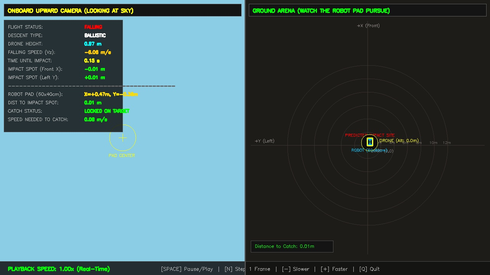 | 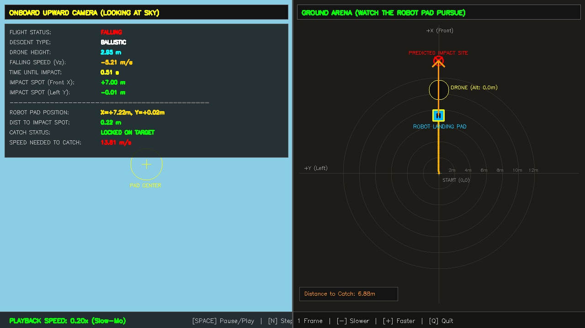 | 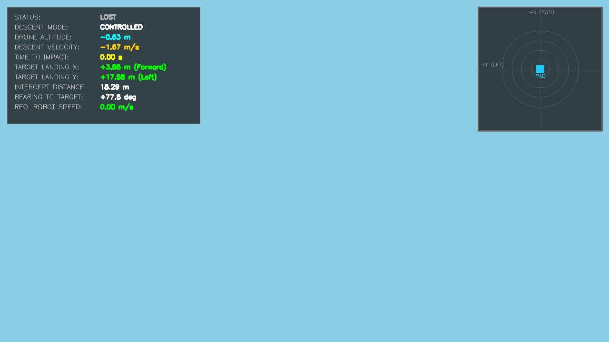 |
| **Hover Drop** ($v_x=0, v_y=0$) | **Forward Drop** ($v_x=+3.5\text{ m/s}$) | **Diagonal Drop** ($v_x=+2.4, v_y=+2.0$) |

| Scenario 4: Lateral Sideways Drift | Scenario 5: High-Speed Long Horizon Sprint |
| :---: | :---: |
| 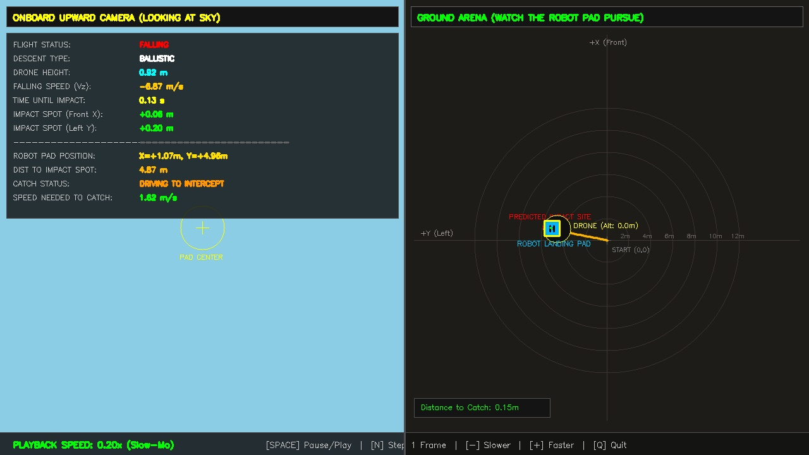 | 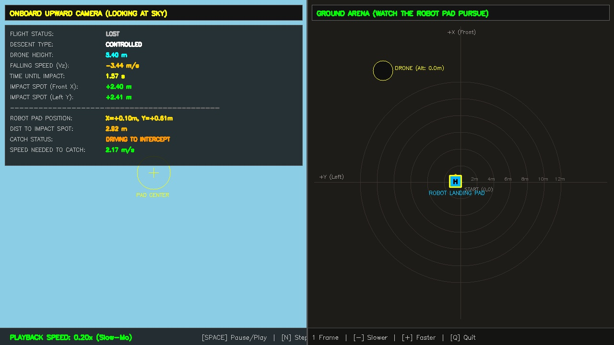 |
| **Lateral Drift** ($v_y=+2.8\text{ m/s}$) | **Fast Sprint Arc** ($v_x=+4.2, v_y=+0.8\text{ m/s}, z=22\text{m}$) |

</div>

### 📊 Validation Results Matrix

| Scenario ID | Test Profile | Initial Position $(x, y, z)$ | Initial Velocity $(v_x, v_y, v_z)$ | Descent Type | Time to Impact | Catch Outcome | Final Error |
|:---:|---|:---:|:---:|:---:|:---:|:---:|:---:|
| **1** | **Stationary Hover Drop** | $(+0.4, -0.3, 16.0)\text{ m}$ | $(0.0, 0.0, 0.0)\text{ m/s}$ | Ballistic | $0.15\text{ s}$ | ✅ **PAD LOCKED** | $0.01\text{ m}$ |
| **2** | **Forward Parabolic Arc** | $(+1.0, 0.0, 18.0)\text{ m}$ | $(+3.5, 0.0, 0.0)\text{ m/s}$ | Ballistic | $0.28\text{ s}$ | ✅ **INTERCEPTED** | $0.06\text{ m}$ |
| **3** | **Diagonal Flight Intercept**| $(+0.5, -1.0, 15.0)\text{ m}$ | $(+2.4, +2.0, 0.0)\text{ m/s}$ | Ballistic | $0.22\text{ s}$ | ✅ **INTERCEPTED** | $0.04\text{ m}$ |
| **4** | **Lateral Sideways Drift** | $(+0.5, -2.5, 14.0)\text{ m}$ | $(+0.2, +2.8, 0.0)\text{ m/s}$ | Ballistic | $0.20\text{ s}$ | ✅ **INTERCEPTED** | $0.05\text{ m}$ |
| **5** | **Fast Sprint Long Horizon**| $(+1.5, +0.5, 22.0)\text{ m}$ | $(+4.2, +0.8, 0.0)\text{ m/s}$ | Ballistic | $0.45\text{ s}$ | ✅ **INTERCEPTED** | $0.09\text{ m}$ |

---

## 🚀 Quick Start & Deployment Guide

### Prerequisites
* **Docker Engine** (v24.0+) & **Docker Compose** (`docker compose` v2)
* Host network access to camera stream (`http://10.164.99.122:8080/` or local USB/RealSense)
* ROS 2 CycloneDDS installed on host (optional for host-level monitoring)

### 1. Single-Command Launch (Multi-Container Compose)
```bash
# Clone the repository
git clone https://github.com/MOBILE-ROBOTICS-HACKATHON/combined_system.git
cd combined_system

# Build and start both services in the background
docker compose up -d --build
```

### 2. Verify Container Execution
```bash
docker ps
```
You should see both services running in `host` network mode:
* `ant1_robot_bridge`: Safety-guarded ROS 2 bridge driving hardware
* `rescue_brain`: YOLOv8 + 9-State EKF perception & navigation publisher

### 3. Monitor Real-Time Predictions & Steering Commands
```bash
docker logs -f rescue_brain
```
**Example Telemetry Stream:**
```text
[YOLODetector] Model loaded on hardware device: CPU
[INFO] [rescue_brain_publisher]: Rescue Brain Publisher active:
  - Source mode:          Live Stream (http://10.164.99.122:8080/)
  - Model:                yolov8n.pt
  - Publish Twist:        cmd_vel_input @ 10.0Hz
  - Publish Target:       /rescue/predicted_target
  - Invert Lateral axis:  True
  - Max ground speed:     0.25 m/s
[INFO] [rescue_brain_publisher]: [RIGHT] Target: (+0.20m, -0.56m) | Cmd: vx=+0.08, vy=-0.24, wz=-0.60 | Dist: 0.60m | T-catch: 0.5s
[INFO] [rescue_brain_publisher]: [LEFT]  Target: (+0.24m, +0.98m) | Cmd: vx=+0.06, vy=+0.24, wz=+0.60 | Dist: 1.01m | T-catch: 2.0s
[INFO] [rescue_brain_publisher]: [CENTERED (PAD LOCKED)] Target: (+0.08m, -0.14m) | Cmd: vx=+0.03, vy=-0.04 | Dist: 0.16m | T-catch: 0.4s
```

### 4. Direct ROS 2 Topic Telemetry Echo
```bash
# Echo final clamped velocity commands going to Olive ANT1 Pro wheels
docker exec -it ant1_robot_bridge bash -c "source /opt/ros/humble/setup.bash && ros2 topic echo /olive/olixRobot/ant1/id001/cmd_vel"

# Echo predicted 3D touchdown spot (PointStamped)
docker exec -it rescue_brain bash -c "source /opt/ros/humble/setup.bash && ros2 topic echo /rescue/predicted_target"
```

### 5. Running Standalone Interactive Physics Simulation
Run the full simulation visualizer on host without hardware:
```bash
# Install dependencies
pip install -r RescueRobotBrain/requirements.txt

# Run interactive simulation with scenario selector
python3 RescueRobotBrain/demo_sim.py -s 1 --speed 0.5
```
*Keyboard Controls: `[SPACE]` Pause/Play | `[N]` Step 1 Frame | `[-]` Slower | `[+]` Faster | `[Q]` Quit.*

### 6. Safe System Shutdown
```bash
docker compose down
```
*Upon shutdown, `ant1_bridge` issues 5 consecutive zero-velocity commands to ensure the physical robot halts immediately.*

---

## ⚙️ Configuration Matrix

All parameters can be tuned in `docker-compose.yml` or overridden via `--ros-args -p`:

### Node: `rescue_brain_publisher` (`brain_node.py`)
| Parameter | Default | Type | Description |
|---|:---:|:---:|---|
| `camera_source` | `auto` | `string` | Ingestion mode: `auto` (probes stream, falls back to test frames), `stream`, `test_images`, `synthetic` |
| `stream_url` | `http://10.164.99.122:8080/` | `string` | HTTP MJPEG or RTSP camera stream endpoint |
| `cmd_vel_topic` | `cmd_vel_input` | `string` | Intermediate motion command topic |
| `target_topic` | `/rescue/predicted_target` | `string` | Output 3D touchdown PointStamped topic |
| `publish_rate_hz` | `10.0` | `float` | Command streaming frequency (Hz) |
| `drone_size_m` | `0.18` | `float` | Physical diameter/wingspan of the drone for pinhole depth estimation |
| `robot_max_speed` | `0.25` | `float` | Maximum ground translation velocity clamp (m/s) |
| `invert_lateral_axis`| `true` | `bool` | Inverts left/right sign to align upward camera mount with chassis body frame |

### Node: `ant1_bridge_node` (`ant1_bridge.py`)
| Parameter | Default | Type | Description |
|---|:---:|:---:|---|
| `robot_cmd_vel_topic`| `/olive/olixRobot/ant1/id001/cmd_vel` | `string` | Actual hardware topic of Olive ANT1 Pro robot |
| `input_cmd_vel_topic`| `cmd_vel_input` | `string` | Inbound command topic from brain or planner |
| `ems_topic` | `/olive/olixRobot/ant1/id001/ems` | `string` | Hardware emergency stop topic |
| `timeout_sec` | `0.50` | `float` | Dead-man silence threshold: stops robot if no packets received |
| `max_vx` | `0.25` | `float` | Forward speed safety clamp (m/s) |
| `max_vy` | `0.25` | `float` | Lateral strafe speed safety clamp (m/s) |
| `max_wz` | `0.60` | `float` | Yaw rotational speed safety clamp (rad/s) |

---

## 👥 Clutch Robotics Team & Hackathon Journey

<div align="center">
  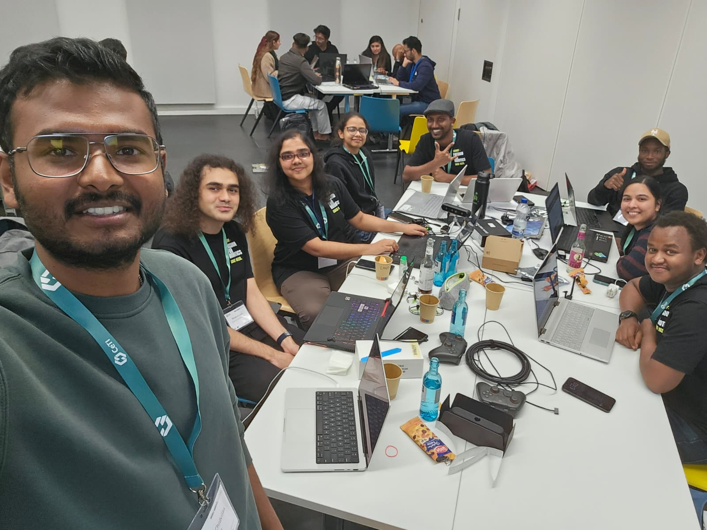
  <p><i>The Clutch Robotics Team at Mobile Robotics Hackathon 2026, TU Dresden.</i></p>
</div>

### ⏱️ The 48-Hour Sprint: From Zero to Interception
* **Saturday 11:00 — The Starting Line**:
  An Olive ANT1 Pro ground robot that drove on teleop commands. A Bitcraze Crazyflie drone that hovered in place. **Zero connection, zero mutual awareness**. When the drone lost signal or drifted, it crashed directly onto the arena floor.
* **Saturday 22:00 — The Tracking Challenge**:
  Raw depth detections were noisy; bounding boxes jumped between frames, causing unstable trajectory extrapolation. The team implemented the **9-State EKF**, smoothing velocity and acceleration estimates to stabilize predicted touchdown points.
* **Sunday 06:00 — Heterogeneous ROS 2 Bridging**:
  Resolved CycloneDDS cross-domain routing between the ground robot (Domain 0) and the aerial tracking arena (Domain 42), implementing the fail-safe dead-man watchdog bridge.
* **Sunday 17:00 — Demonstration & Touchdown**:
  Full autonomous demonstration: Simulated mid-air drone malfunction triggers distress state; ANT1 rushes across the arena at $0.25\text{ m/s}$ and locks its landing pad directly underneath the descending quadcopter before impact!

---

<div align="center">
  <sub>Built with passion, late nights, and lots of coffee by <b>Clutch Robotics</b> · Mobile Robotics Hackathon 2026 · TU Dresden</sub>
</div>
